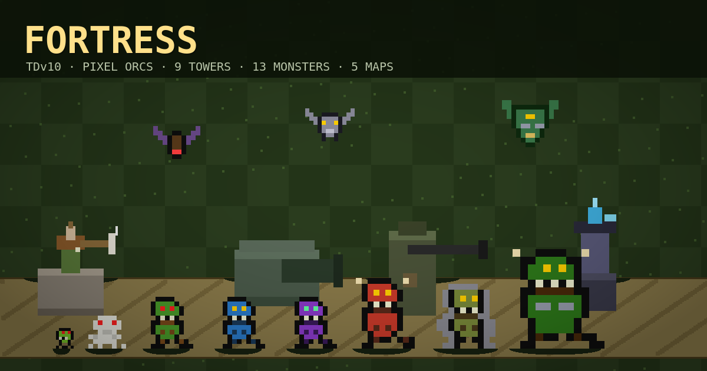

# Gretsanti

Launcher, group chat, Aurora and Pindutan — plain HTML files, no build step, no framework.

**The live copies run on the PHP host.** Pages is not used: the files are uploaded to the host and opened
from there. The repository is public, which is what lets a hosted page read a build file from it.

| What | Address |
|---|---|
| Launcher | `https://aidekupal.unaux.com/index.html` |
| Aurora | `https://aidekupal.unaux.com/Aurora.html` |
| Group chat | `https://aidekupal.unaux.com/gc-v5.html` |
| Pindutan | `https://aidekupal.unaux.com/pindutan-run.html` |
| FreeModel relay | `https://aidekupal.unaux.com/api-free.php` |

## Files

| File | Size | What |
|---|---|---|
| `index.html` | 31 KB | Launcher (an upload of `index-v5.html`) — Pindutan opens a three-slot picker, slot 3 plays the newest build |
| `index-v5.html` | 54 KB | Launcher in use — motion, and cards that open the file name the host actually has |
| `gc-v5.html` | 139 KB | Group chat — KDL skin, lightning storm, sky of stars/satellites/rockets |
| `api-v5.php` | 43 KB | Backend for the chat: log, presence, uploads, single admin slot |
| `aurora-v4.html` | 118 KB | Aurora — FreeModel only, KDL skin |
| `api-free.php` | 10 KB | FreeModel relay — key typed once in a browser form, streamed answers |
| `worker-free.js` | 5 KB | Same relay as a free Cloudflare Worker, for a host that blocks cross-site calls |
| `aurora-v3.html` · `aurora-v2.html` · `Aurora.html` | 96 · 83 · 53 KB | Older Aurora builds, kept as fallback |
| `pindutan.html` | 35 KB | **The game hub — Alpha** — the page the first runner opens: **the password gate**, then four chairs, all four live (Pindutan, Chess, Zumang, Fortress), what changed and a short about-this-page. Holds no game code, keeps itself current from `menuBuild`; its chairs load `feed.arena`, `feed.chess`, `feed.three` and `feed.fortress` |
| `labs/zuma.html` | 108 KB | **Zumang, game three** — a zuma-style marble shooter on a carved stone board: a jade frog idol flanked by two gold sunbursts aims at your pointer (or your finger) and fires on click or **Space**, a chain that inserts where the marble lands, 3+ of a colour pops, a cut chain **pulls its back half up** to the front and chains the reaction, power-up marbles (🌀 reverse, 🐌 slow, 💣 bomb), a shot that misses breaks on the wall instead of bouncing, rings blooming where a colour pops, a gold quota gauge and green life gems on an ornate bar over the board (score, lives, quota — no level plate), a gold skull at the end of the track, the levels a name has **finished** ticked ✓ in the grid so they can be picked again, **100 levels in ten temples, each with a board of its own** (spiral, serpent, corridor, rosette or ring, fixed by the level number) with the pace, colours and quota tightening, Web Audio sound made from oscillators, a nickname door, and a score kept **by name** on the device with a **solo** post to the ladder when there is a signal |
| `labs/fortress.html` | 58 KB | **Fortress, game four** — pixel-orc tower defence (TDv11, the Royal Knight build): a 15x10 tile board, **nine towers** (Archer, Cannon, Frost, Sniper, Poison, Tesla, Laser, Mortar, and a Bank that pays 8 gold every 4s), **eighteen monsters** — thirteen orcs, bats, gargoyles, wyverns, a warlord and a sky warlord, plus five classic archetypes (Goblin Sapper, Shielded Vanguard, Siege Ram, Dark Necromancer, Sky Harpy). Some **fly** straight over the walls, and the Cannon and the Mortar cannot touch them; shields eat steel and let magic through, the ram's armour eats steel and not fire. **The Royal Knight** is playable: tap him, tap the board, he holds the road; Royal Aura fires nearby towers 18% faster and Shield Bash stuns around him on a 12s button. It opens on a **boot screen** that caches `TD/resources/assets.json` behind a progress bar, and every sprite keeps a character-grid fallback, so a missing PNG is invisible. **Five maps** (Forest Trail, Serpent Pass, Swamp Loop, Frozen Canyon, Ashen Fortress) swap every five waves, refunding 60% of any tower the new road swallows; after wave 20 the stage loops at **+50%**. Tap a tower to upgrade (+35% dmg, +10% range a level), shift-tap to sell for 60%. Menu flashes, projectile trails, death bursts, floating damage numbers and a wave preview. Locked to 60 fps. **Every one of the 36 sprite slots takes a PNG** — towers, the knight and the HUD portrait included — and `TD/tools/install-sprite.js` refuses a picture with the wrong shape or no alpha before it ships. Build tag **f4**, opened from `fortress`/`fortressBuild` |
| `TD/` | 2 KB | **The tower defence's art root** — `images/{towers,troops,monsters,heroes,ui}/` (36 keys), `resources/assets.json` (the manifest: key → path), `assets/` and `audio/` reserved. The game reads the manifest from `../TD/`, then from `main`, then from the copy written into the page; every key keeps a drawn canvas fallback, so a missing PNG never blanks a sprite or throws. `TD_OVERHAUL_NOTES.md` holds the prompt and filename for all 36 |
| `labs/chess.html` | 96 KB | **Chess, game two** — complete rules (castling, en passant, promotion, mate, stalemate, fifty-move, threefold, dead positions), VS CPU at three levels, two players on one page, **an online lobby over three relays with tap-to-challenge, a coin toss for colours, chess clocks, rematch, PGN/FEN and a scoresheet you can tap back through**, keeps itself current from `chessBuild`, six page themes, eight board palettes with a tint slider, three piece styles |
| `Screenshot.html` · `save.php` | 3 · 1 KB | Collectibles vault — password-gated image board |
| `index-v1…v4.html` · `gc`/`gc-v2…v4` · `api-v2…v4.php` | — | Archive, one design generation each |
| `agent-widget.js` · `api-ai.php` · `agent-demo.html` | 22 · 13 · 4 KB | Floating agent bubble any page can load |
| `diag.html` | 8 KB | Link diagnostic — says whether the PHP host answers, and why not |
| `pindutan-run.html` | 7 KB | **The first runner, frozen at the Nov 26 file** — no game code and no menu; reads the feed and opens `feed.html`, the hub. Left alone on purpose: every change since lives in the hub and the game |
| `labs/pindutan-v21.html` | 288 KB | Pindutan v31 — the game: the arena, its four chairs behind ☰ Games (**Chess**, **Zumang** and **Fortress** each open from the feed by their own field, checked before they run), a hall of fame with two boards (**1V1** and **Royale**, no **All**), Royale tiers read off Royale wins, and a **new season** button, and the build that keeps itself current. The gate opens straight on the nickname now. The **GLIDE** panel sets how a held piece moves, for the arrow keys and the on-screen ◀ ▶ ▼ alike |
| `labs/pindutan-v20.html` | 192 KB | Previous Pindutan build, kept as the tested copy |
| `labs/pindutan-build.json` | 1 KB | The build pointer — which Pindutan is newest, where the deck lives (`menu` / `menuBuild`), and the ladder's address |
| `labs/worker-leaderboard.js` | 14 KB | The ladder as a Cloudflare Worker, for when a PHP host is not wanted |
| `wrangler.jsonc` | 1 KB | Cloudflare build config — the worker, its entry file, and its KV box |
| `labs/index.html` | 12 KB | The experiment list |
| `labs/` | 7 KB + | Experiments: Castle Defense, Call Spider (one file), the transcript extension, the auto clicker APK |

## Latest changes

**Build numbers — v21 stops at nine.** A minor number is one digit, so a build after `v21.9` is `v22`, and the
ones after that are `v22.1`, `v22.2` … up to `v22.9`, then `v23`. The file the board lives in keeps its old
name, `labs/pindutan-v21.html`, so the feed and every saved copy keep working; only the tag on the page moves —
the badge reads `v22` and the line under the wordmark reads `v22.1`.

**Launcher — Pindutan opens a short list before the game.** PLD-02 no longer jumps into a fixed build. It
opens a picker with three rows — **1** and **2** sit there marked `TBD` (greyed, waiting for a game), and **3
Pindutan · our latest build** reads `labs/pindutan-build.json` on `main`, fetches the build that file names,
refuses a half download, and hands the whole page over to it once it is whole. So the launcher is a runner
too, and `pindutan-run.html` is left exactly as it was. No signal, and it says so, with **Try again** and the
hosted copy. Both launchers carry it, `index.html` and `index-v5.html`, and a saved grid moves with it —
`pindutan.html`, `pindutan-v18/20/21.html`, `labs/pindutan-v21.html`, the hosted copies and even
`pindutan-run.html` all open the list now. To fill an empty row, give it a `url` in `PINDUTAN_SLOTS`. The deck
at `pindutan.html` keeps its own four chairs for the runner and for anyone who opens it directly; nothing
here changes it. Also fixed in both launchers: the wording and upgrade tables were declared below the
"still unlocked" check, so a reload hit a dead zone inside `getApps()`, the `catch` swallowed it and the
player's saved grid was thrown away — they are declared above that check now.


**Pindutan runner — one small file, always the newest game.** `pindutan-run.html` holds no game at all: it
reads `labs/pindutan-build.json` on `main` and then loads the build that file names, so a copy kept on a phone
never goes stale. If the repo cannot be reached it says so, offers a retry and a link to the hosted copy.

**Runner → hub → game.** The first link is frozen; everything after it keeps itself current.

1. `pindutan-run.html` — the **first runner**: no game, no menu. Reads `labs/pindutan-build.json` and opens
   `feed.html`. It refuses anything under 20 KB that is not a whole page carrying the `SELF-UPDATE` marker, and
   if it cannot get one it says why, offers a retry and a link to the hosted copy. **This file is frozen**:
   it is byte-for-byte the version from Nov 26 and is not to be touched again — which is exactly why the hub
   below is 29 KB and still carries that marker.
2. `pindutan.html` — the **game hub (m15)**, wordmark **Alpha**, 35 KB, no game code. It asks for **the
   password** first — that is where the lock lives now — and then shows four chairs: **Pindutan** opens the
   build the feed calls `arena`, **Chess** opens `chess`, **Zumang** opens `three`, and **Fortress**
   opens `fortress`. Under the chairs:
   **what changed** and a short **about this page**. The hub keeps *itself* current
   from `menuBuild`/`menu`, and it checks the feed on every open and on every tap of its strip.
3. `labs/pindutan-v21.html` — the **arena** (v31): the game. It carries the same four chairs behind a
   **☰ Games** pill in its header, and it updates itself from `arena` in the feed. A chair reads its own field
   (`arena`, `chess`, `three`, `fortress`), fetches that file, refuses anything that is not a whole page with
   the right marker, and only then hands the tab over to it — so the pill opens the newest Fortress, not a copy
   kept inside the arena. Its gate opens **straight on
   the nickname**: the password step is gone, because it is asked one page earlier, in the hub.



`labs/fortress.html` is game four: **Fortress**, 58 KB, build tag **f4**, opened from `fortress`/`fortressBuild`
in the feed. It is a pixel-orc tower defence on a 15x10 grid: nine towers, **eighteen** monsters, five maps that
swap every five waves, flyers that the cannon and mortar cannot reach, and a loop after wave twenty at +50%.
It opens on a **boot screen** — crest, progress bar, three of its own sprites — that caches the art from
**`TD/resources/assets.json`** before the first frame, and every sprite still has a drawn fallback, so a missing
PNG is invisible and the page never waits on the network. **The Royal Knight** is playable: tap him, tap the
board and he holds that ground; his *Royal Aura* fires nearby towers 18% faster, and *Shield Bash* stuns the
horde around him on a 12-second button. Five classic archetypes joined the horde — the **Goblin Sapper**
(swarm), the **Shielded Vanguard** (shields eat steel, magic goes through), the **Siege Ram** (armour, six
lives), the **Dark Necromancer** (heals, raises, wards) and the **Sky Harpy** (anti-air only). All of the art
in `TD/` is scaffolded and mapped; `TD_OVERHAUL_NOTES.md` carries the image prompts and the exact filenames.

**The `TD/` art root.** Everything the tower defence draws lives in one folder, mapped key by key in
`TD/resources/assets.json`:

```
TD/images/{towers,troops,monsters,heroes,ui}/  36 keys, one folder each
TD/resources/assets.json                       the manifest: key → path
TD/assets/  TD/audio/                          reserved for atlases and sound
```

The game looks for the manifest at `../TD/…` (which is `/TD/…` whether the page is served from `labs/`
or written into the arena), then on `main`, then falls back to the copy written into the page — so
hosted copies, phones and offline all boot. Every key has a **drawn canvas fallback**: the character
grids are the art until a PNG lands, which is why a missing file can never blank a sprite or throw.
`KDL_FORTRESS.spriteMode(key)` says `png` or `drawn`, and `TD_OVERHAUL_NOTES.md` has the prompt and
the filename for all 36.

`labs/zuma.html` is game three: **Zumang**, 108 KB, build tag **m3**, opened from `three`/`threeBuild` in the
same file. Its door is the same door chess has — a nickname, once, before the board — and the name it is given
is the key to everything after it: the best score, the levels opened, the sound preference, all kept on the
device under that name, and the run posted to the ladder as a **solo** score (a score, not a battle: it never
touches a win column). With no signal the run is still saved locally and the board says the ladder is out of
reach; when the signal comes back the next run posts.

**Zumang — how it plays.** The track is a Catmull-Rom spline through the map's waypoints, and every marble's
position is a distance along it, so a chain is just a front position and a list of colours: inserting a marble
re-spaces the whole run along the curve instead of moving it in straight lines. Three or more of a colour
pop; the piece that was cut free is then **pulled forward** until it touches the piece in front, which is what
makes a chain reaction possible — if the two ends match, they pop too, and the combo multiplier climbs to ×9
while the reactions keep coming. The frog is placed automatically in the roomiest pocket near the middle of the
map, so every map gets a shooter that can actually see the track.

**A missed shot breaks on the wall.** A marble fired into bare stone dies where it strikes, with a small puff of
dust, instead of bouncing off the edge and possibly finding a match on the way back — missing costs a marble,
not a lucky one. The aiming line walks the same walls, so it stops where the shot would. When a colour does pop,
a white strike ring and a ring in that colour bloom from the spot with a soft glow under them, wider for bigger
runs and higher combos, and a three-chain shakes the board slightly.

**The save remembers the levels a name has finished.** Each name carries a `done` list beside its best score and
the level it has reached; the level grid paints a finished level with a green **✓** and lets the picker start it
again, while levels the name has not reached stay locked. A save written before this build has no `done` list and
is read as finished up to the level the name had already reached, so nobody loses a cleared temple. The ornate
bar carries the score, the lives and the quota — the level plate is gone from it, and the level's name only greets
you where a level opens.

**A hundred boards.** Each level draws its own map from five generators — spiral, serpent, corridor, rosette and
ring — seeded by the level number, so a board is the same board every time you come back to it, and all five
shapes are used in every twenty levels. Each candidate line is **checked before it is used**: long enough for a
stage (44–68 marbles), inside the board past the way in, no two turns of the track closer than a marble and a
half, and a clear pocket near the middle for the frog. A board that fails is drawn again with another seed, so a
level can never open on an unplayable track. The quota is a share of the track rather than a fixed number, so a
level plays the same on a phone and on a desktop, and losing a life brings the snake again from the start — the
quota starts over with it, so a life lost can never leave an empty track that would count as a cleared level.

`labs/chess.html` is game two: a complete chess app of its own, 96 KB, with its own build tag (`c6`) and its
own feed field, so it updates itself the same way the arena does. It reads `chessBuild`/`chess` from the same
small build file, checks that the page it finds is whole and really calls itself that build, and opens it —
`sessionStorage` stops a copy that was just swapped in from swapping again.

**Chess — the whole game, not a demo.** The rules are the real ones: castling on both sides with every
restriction (rights, empty squares, no castling out of, through or into check), en passant, all four promotion
pieces, check, checkmate, stalemate, the fifty-move rule, threefold repetition and dead positions (K vs K, K+B,
K+N, bishops on one colour). The move generator is proved by perft — 20 / 400 / 8902 from the start position,
48 / 2039 from Kiwipete, 6 / 264 from the promotion position, 44 / 1486 from the tricky middle game — and the
scoresheet is written in real SAN, with disambiguation and `+` / `#`. Play the CPU or two players on one page.

**The three CPU levels are three different players.** Beginner looks one move ahead, does not follow captures
through and throws a move away one time in five; Intermediate looks two moves ahead, takes anything left
hanging, and still slips once in twelve; Advanced looks three moves ahead, follows every capture to the end and
never slips. The search is a White-positive alpha-beta with a quiescence pass, and the evaluation knows about
material, piece-square tables, a bishop pair and doubled pawns. The look is
yours: six page themes, eight board palettes with a tint slider that recolours both squares, and three piece
styles (classic, outline, neon). Everything you pick is remembered.

**Chess online — one lobby, no room codes.** The same three public brokers Pindutan uses (EMQX, HiveMQ,
Mosquitto) carry one lobby channel (`kdl/chess/v1/lobby`); a BroadcastChannel and a storage bus cover the tabs
on one device for a browser that blocks WebSockets or the relay library. Names appear in the lobby as players
arrive and drop off after twelve silent seconds. Tap **⚔** beside a name and a temporary room
(`kdl/chess/v1/m/<id>`) is opened for the two of you, with an **Accept / Decline** bar at the other end.

**The colours are tossed, not handed out.** Both players put a coin in; if the two coins agree the inviter has
White, if they disagree the other player does. Each side works the answer out from the same two numbers, so both
of you agree, and neither can steer it. A toss bar slides in and names the colours, and the board turns round
for whoever gets Black. A rematch tosses again, so the colours change hands.

**Clocks, if you want them.** 3+2, 5+0, 10+0, 15+10, or none at all. The increment is added as you move, the
clocks travel with every move so both sides agree on the time, and a flag that falls ends the game for both of
you — sent as a `FLAG` packet, not left to the loser to admit. The room stays open when a game ends so a
**rematch** is one tap away, and **PGN / FEN** are one more (both copyable). Tap any move on the scoresheet to
look at that position; the live game never moves while you look.

Moves travel as squares and are re-checked with the local rules before they are played, so a stale or bogus
packet cannot put an illegal piece on your board; resign, draw offers and rematches travel the same way, and a
player who goes quiet is named on the match bar rather than left hanging.

**Two boards on the hall of fame, and two kinds of rank.** The tabs are **1V1** (`mode=duel`) and **Royale**
(`mode=group`) — the old **All** tab is gone, because a board that adds two games together ranks nobody.
1v1 keeps the star rank, built from wins minus losses: bronze, silver, gold, diamond, three tiers of three
stars and a fourth that steps you up. Royale has a rank of its own and a kinder one: the tier is read straight
off the Royale wins — **Unranked** to 4, then **Herald** at 5, **Guardian** 10, **Crusader** 15, **Archon** 20,
**Legend** 25, **Ancient** 30, **Divine** 35 and **Immortal** from 40, with no ceiling above it. Only a win
moves it, so **a match you lose can never take a Royale tier away**; the five pips beside the tier are the wins
into the next one. Nothing about a tier is stored — `royaleRank(wins)` in the game is the whole rule, which is
also why resetting the wins is all it takes to reset a rank.

**Three modes, and the third one is not a battle.** The ladder takes `duel`, `group` and, since Zumang,
`solo`. A solo report carries a score and the level reached, and it lands on its own board: the worker and the
PHP both keep it out of the win/loss/streak counters and out of the battle best, so a Zumang run can never
make somebody look like a better duellist. `?action=top&mode=solo` reads that board back.

**A new season, when the board needs one.** The hall of fame carries a quiet **↺ New season** button. It asks
once, then posts `?action=reset` with the shared key to whichever host the ladder lives on, throws away the local
copy, and redraws an empty board for everyone. A refused key and an unreachable host both say so on the note
under the list instead of pretending the wipe happened.

**Resetting one board, from the maker's window.** The same endpoint takes a narrower body: `{key, mode}` clears
that board for everyone and `{key, mode, name}` clears it for one player, in the worker and in the PHP alike.
Wins and losses go, a best score stays, and the totals for `mode=all` are added up again from `duel` and `group`
so the older board cannot keep saying a number nobody has any more. God mode draws it as two sections — 1v1 and
Royale — with a reset on every name and one for the whole board; each asks first, then clears the records on
that phone, the rows other phones handed it, the cached copy, the host, and every phone in the room (an `LBRS`
packet only a crowned maker can send). A ladder only counts upwards, so a copy that is not told would hand the
win straight back.

The feed names an address per link: `html` (the hub the runner opens), `arena` (the game the hub
opens, and the file the game updates itself from), `chess`/`chessBuild`, `three`/`threeBuild` for Zumang,
`fortress`/`fortressBuild` for Fortress, and `menu`/`menuBuild` (the hub's own address and tag).
Pointing `html` at the game instead takes the runner straight to Pindutan and skips the hub — one field, no
upload.

**And the hub keeps itself current too.** On opening — and on a tap of its strip — the hub compares its own
tag with `menuBuild` in the feed (currently `m15`). If a newer hub is out it fetches it, checks it (`HUB-MENU` marker, `</html>`,
size, and that it really calls itself that build), then hands the page over; `sessionStorage` stops a hub that
was just swapped in from swapping again. The strip says which copy you are on in one line — `hub m4 · newest ·
arena v22.9` — turns cyan while it looks, amber when it cannot, and admits `offline` without losing the menu.

**Pindutan v22 — the page keeps itself current.** Open a copy and it reads one small file from this repo,
`labs/pindutan-build.json`; if that names something newer, it runs that instead. A hosted copy moves to the
new page — same address, same saved name, same ladder. A copy kept on a phone has the newer page written over
itself, after letting go of its relays, its lobby channel and its timers, so two versions never talk at once.
No signal, or a half download, and it simply plays the copy it has. **The game is uploaded to the host once
and never again**; publishing a build means putting it on `main` and bumping the tag in that one file.
Everything from the v20 line is inside it: the name gate and the hall of fame (wins from human battles only,
carried up to `api-leaderboard.php`), a **GLIDE** panel that sets how a held button moves — five presets and
four sliders, remembered on that phone — and two small pills beside RELAY, a green lamp then **K** or **I**,
that hand your own board to the Kupal brain or the Intermediate one in a 1v1, a group battle and against the
CPU, with the lit pill again to take your hands back. The three CPU levels were measured and rebuilt because
they had been playing the same best move: Beginner now settles for lesser spots and taps slowest,
Intermediate is brisk and leaves the odd hole, Kupal looks a piece ahead and barely waits.

**Pindutan v17 — you can see your opponent now.** In 1v1 and group battles the opponents panel was never
switched on (CSS hid it and nothing showed it again), and a SYNC without a board wiped the last board
anyway. Now, during a battle, a short strip under the board shows every rival's board live, about 4 frames a
second with the falling piece. The last one standing gets **YOU WIN** or **LAST ONE STANDING**, the rest get
**YOU LOSE** or **KNOCKED OUT**, and **Rematch** re-invites the same players. A group invite stays open for
its full window, and someone who joins late is added without restarting anyone. Boards travel as 200
characters on a new `pindutan/v17/` topic, so old v16 tabs stay in their own room.

**Aurora v4 — FreeModel only.** One platform, `https://freemodel.in/v1`, default `deepseek-v4.1-flash`.
Every other provider name is gone from the page and a test greps for 13 of them. A key inside an HTML file
cannot be hidden — hashing is one-way — so the key lives in `api-free.php` on the server and the page sends
no `Authorization` header at all.

**Why "Failed to fetch".** FreeModel does not let a page on another site call it. The page now says that
plainly instead of blaming the key, the Proxy box refuses FreeModel's own address, and **🩺 Test connection**
checks both doors — the model list, then one real chat request — and saves the address it proved.

**Launcher.** Cards resolve the real file name on the host (`Aurora.html` vs `aurora-v4.html`), remember the
answer, and never read a refused probe as a missing file. The Pindutan card opens a three-row picker, and
row 3 runs the newest build from the repo. Relative cards point at the PHP host, so the
launcher works wherever it is opened from.

**Chat.** The KDL // MISSION CONTROL skin — pure black deck, hairline grid, square corners, mono caps, one
cyan accent. A cyan lightning storm fires on send and on arrival, and a sky runs behind the messages: stars
drifting, satellites on slow orbits, a rocket every few seconds. Paused when the tab hides, off under
`prefers-reduced-motion`.

**Security.** The key never enters the repository and never enters the page. Pasted keys are treated as
leaked — revoke them. `.fmkey.php` on the server starts with `<?php exit; ?>`, so it reads blank over the web.

## Checks

All suites run in Node with jsdom, no browser needed.

- **Chat v5** — 71 · **v4 features** 37 · **v3 features** 41 · **API errors** 14 · **Pages** 11
- **Chat skin and sky** — 31: palette, square corners, mono caps, storm on send and arrival, canvas seeds
  stars and satellites, loop runs, survives a missing canvas, gone under reduced motion
- **Launcher** — 70: every card resolves to the PHP host, `Aurora.html` found when `aurora-v4.html` is
  missing, refused probe never read as missing, chosen name remembered
- **Pindutan v22** — 236: engine, glance rules, rooms over four paths, the lobby (created by KDL under the
  wordmark, the room line beside the word Lobby, the name given once at the gate and then carried only by
  your card — no box to change it, nothing repeating it beside Watch — a card that is a name and
  Playing/Available and nothing
  else — the ladder is the only place that keeps score), the table (your board on the left, your rival's
  beside it on the right at 72% of its width, a group battle or watching keeping the full-width strip
  underneath), the lobby chat (words
  ride the relay, never stored, markup shown as words, 80 characters, one message a second, floods turned
  away, five lines tall), the maker's God mode (a button beside Watch that opens inside the same tab a list of
  everyone else — Kick, Ban, and Unban; a kick empties that phone's room until it reloads, a ban is written on
  the maker's phone and only Unban undoes it, and a banned phone is simply not heard), the three-second countdown (a frozen board and a frozen CPU until GO, and for
  whoever is facing the maker in a 1v1 or a group battle one line above the numbers — “You are challenging
  the creator, Goodluck!”, which the maker never reads), the storm
  (lightning for the whole room — three jagged vector bolts, each eight points of zig-zag, drawn as SVG so
  they stay sharp on any screen — a four-second fanfare the moment the maker's key is taken, a maker-only
  ⚡ beside the relays that broadcasts, a second bolt inside 600 ms held back), eight themes that stick — the last two
  are skies: a launch pad whose three satellites and two ships fly over the page as thin line art with mission tags,
  on an arc and a climb rather than a straight line, dimming when nobody is playing, and a
  Christmas night whose snow falls over the whole page and is stopped by the table itself — the player card
  behind a row tap (wins, best, the win rate worked out from what was played, the run of wins you are on,
  last seen — no losses), the ladder (two boards, 1V1 and Royale, ten names each: the 1v1 stars — bronze,
  silver, gold, diamond, three tiers of three stars and a fourth that steps you up — and the Royale tiers read
  off Royale wins, Unranked to Immortal, which a loss can never lower —
  your own row reading "(you)", and
  the note that speaks of Cloudflare when the board lives there), an update log that opens by itself the first time
  you reach the lobby on a new build — three days of notes, and "Do not show again" in the lower right corner, with a
  📜 Updates pill beside Themes for anyone who wants it back — and the page acting as its own runner: a build strip
  under the wordmark that names the copy it is running, looks for a newer one on every open and whenever the tab comes
  back, and offers `pindutan-run.html` when GitHub cannot be reached — the CPU rival and its three levels, the name gate,
  the hall of fame (the note names whatever host the feed points at), the GLIDE panel, hold-to-slide, the
  pills, and the self-update (nothing newer leaves it alone, a newer build comes over whole, a broken
  download refused, a swap lets go of the relays first, the feed tag must match the game's own)
- **Launcher picker** — the Pindutan card opens the list, rows 1–2 are TBD and unclickable, row 3 reads the
  feed, a half download is refused, an offline start offers retry and the hosted copy, and a saved grid from
  any old Pindutan target lands on the list
- **Pindutan v17** — 48 · **Pindutan v18** — 273 · **Chess** — 84 · **Zumang** — 53 · **hub and runner** — 30 · **sprite installer** — 25 · **labs pages** — 20 · **leaderboard PHP** — 36 · **leaderboard worker** — 26
- **Fortress** — 97 · **Castle Defense** — 34
- **Aurora v4** — 49 + 54: only FreeModel survives, proxy sends no key, CORS wall named, dead relay gets its
  own message, Test connection proves a chat request
- `api-free.php` and `api-v5.php` are parsed with a real PHP grammar (no PHP binary in the sandbox), and
  every page's CSS goes through PostCSS before it ships
